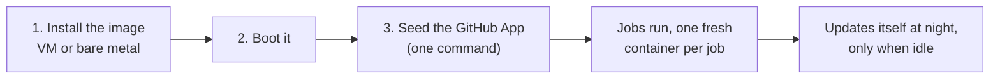

# github-runner-bootc

A [bootc](https://containers.github.io/bootc/) image (Fedora 45, x86_64) that turns a VM or a bare-metal host into
ephemeral self-hosted GitHub Actions runners. Every job runs in a fresh container from the
[ARC runner image](https://github.com/cthtrifork/talos-gitops).

| Image | Runner image | Size | Use it when | Links |
|---|---|---|---|---|
| `ghcr.io/cthtrifork/github-runner-bootc` | pulled once on the first boot | small | the host can reach a registry or a mirror | [package](https://github.com/cthtrifork/github-runner-bootc/pkgs/container/github-runner-bootc) |
| `ghcr.io/cthtrifork/offline-github-runner-bootc` | embedded in the OS image | about 3.5 GiB larger | the host has no registry or network (airgap) | [package](https://github.com/cthtrifork/github-runner-bootc/pkgs/container/offline-github-runner-bootc) |

Both are published with every build of `main` and the weekly rebuild: see the [releases](https://github.com/cthtrifork/github-runner-bootc/releases)
for the tags and the changes, and the [architecture](docs/architecture.md) for how it fits together.

## Why

Self-hosted runners usually mean two things to look after: an operating system (patching, drift, snapshots) and the
runner software on top of it (installing, registering, upgrading, cleaning up between jobs). This project makes them
one artifact:

- **One image, one lifecycle.** The OS, the runner and its tooling are built, tested and versioned together. The host
  updates itself atomically and rolls back if something breaks, so there is no separate OS patching or runner upgrade.
- **Clean by default.** Every job runs in a fresh container, so nothing leaks from one job to the next and the host does
  not accumulate state.
- **Nothing to rebuild by hand.** A new host is a disk image plus one seed command; a broken host is replaced, not repaired.
- **Airgap friendly.** The runner image ships inside the OS image, so the host needs no registry, only GitHub.
- **No secrets in the image.** The GitHub App key is seeded at first boot and never baked in.



## Use it

1. **Install:** write the raw disk image to the disk with `dd`, or run `bootc switch` to one of the images above on a
   host that already runs bootc. An ISO is planned (see #20).
2. **Seed the GitHub App** (Administration: read and write; the key never goes into the image):

   ```
   sudo github-runner-seed-app --scope repo:owner/name --app-id <Client ID> --installation-id <id> [--instances 2] key.pem
   ```

   Use `--scope org:name` for an organization.
3. **Target it** with `runs-on: [self-hosted, bootc]`.

Airgapped sites: point `/etc/containers/registries.conf.d/` at an internal mirror for the OS and runner images, `chrony`
at an internal NTP server, and put extra `Volume=` lines (private CA, mirror config) in
`/etc/containers/systemd/github-runner@.container.d/10-site.conf`. The runner itself only needs GitHub.

## Security

The runner container is privileged (it runs podman and buildah inside), so **a job is root on the host**. Use a
dedicated host and attach it only to private or trusted repositories through a runner group. This repository is public:
never point its own PR workflows at it.

## Contributing

See [docs/architecture.md](docs/architecture.md). PR titles follow [Conventional Commits](https://www.conventionalcommits.org/).
