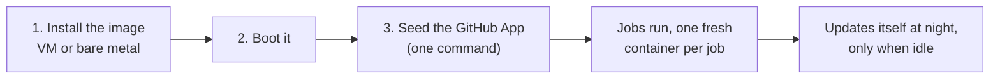

<p align="center"></p>

# github-runner-bootc

[](https://github.com/cthtrifork/github-runner-bootc/actions/workflows/build.yaml)
[](https://github.com/cthtrifork/github-runner-bootc/actions/workflows/lint.yaml)
[](https://github.com/cthtrifork/github-runner-bootc/releases/latest)
[](https://github.com/cthtrifork/github-runner-bootc/releases/latest)
[](https://github.com/cthtrifork/github-runner-bootc/commits/main)

A [bootc](https://containers.github.io/bootc/) image (Fedora 45, x86_64) that turns a VM or a bare-metal host into
ephemeral self-hosted GitHub Actions runners. Every job runs in a fresh container from the official
[GitHub Actions runner image](https://github.com/actions/runner/pkgs/container/actions-runner).

| Image | Runner image | Download (compressed) | Installer ISO | Use it when | Links |
|---|---|---|---|---|---|
| `ghcr.io/cthtrifork/github-runner-bootc` | pulled once on the first boot | 1.0 GiB, then 0.5 GiB on the first boot: 1.5 GiB | [2.2 GiB](https://shared-files.portableinfo.cloud/github-runner-bootc-latest.iso) | the host can reach a registry or a mirror | [package](https://github.com/cthtrifork/github-runner-bootc/pkgs/container/github-runner-bootc) |
| `ghcr.io/cthtrifork/offline-github-runner-bootc` | embedded in the OS image | 1.5 GiB, nothing more to pull | [2.7 GiB](https://shared-files.portableinfo.cloud/github-runner-offline-bootc-latest.iso) | the host has no registry or network (airgap) | [package](https://github.com/cthtrifork/github-runner-bootc/pkgs/container/offline-github-runner-bootc) |

The total is the same: the offline image only moves the runner image from the first boot into the OS image. Sizes are the
compressed registry sizes of the latest release; the installed system and the jobs' images and builds need much more disk,
so plan for tens of GiB.

### Disk space

| | Installed (measured) | During an update | Plan for |
|---|---|---|---|
| Default | 11 GiB: OS 2, runner image 8 | 13 GiB: the staged image doubles the OS | 60 GiB |
| Offline | 14 GiB: OS 5, runner image 8 | 19 GiB: the staged image doubles the OS | 60 GiB |

The installed sizes above were measured with the previous, larger runner image (2.9 GiB compressed); the official one is 0.5 GiB, so expect less. A new runner image version briefly needs space for a second copy of it while it replaces the old one. The jobs' own images and builds
need space too (an estimate: 20 GiB per runner instance, `--instances`), so add that to the 60 GiB.

Both are published with every build of `main` and the weekly rebuild: see the [releases](https://github.com/cthtrifork/github-runner-bootc/releases)
for the tags and the changes, and the [architecture](docs/architecture.md) for how it fits together.

## Why

Self-hosted runners usually mean two things to look after: an operating system (patching, drift, snapshots) and the
runner software on top of it (installing, registering, upgrading, cleaning up between jobs). This project makes them
one artifact:

- **One image, one lifecycle.** The OS and the runner are built, tested and versioned together (one tag for both). The host
  updates itself atomically and rolls back if something breaks, so there is no separate OS patching or runner upgrade.
- **Clean by default.** Every job runs in a fresh container and its workspace is wiped, so the host does not accumulate
  state. Image storage and caches are kept between jobs for speed unless you seed with `--isolate-jobs` (see Security).
- **Nothing to rebuild by hand.** A new host is a disk image plus one seed command; a broken host is replaced, not repaired.
- **Airgap friendly.** The offline image ships the runner image inside the OS image, so the host needs no registry, only GitHub.
- **No secrets in the image.** The GitHub App key is seeded at first boot and never baked in.



## Use it

Step by step, from the ISO to the first job: the [install guide](docs/install.md). In short:

1. **Install:** boot the installer ISO, write a raw disk image to the disk with `dd` (you build it, see below), or run
   `bootc switch` to one of the images above on a host that already runs bootc. An installer ISO is experimental (see #20): every release replaces it at a stable URL, with no versioned copies.
   Download [`github-runner-bootc-latest.iso`](https://shared-files.portableinfo.cloud/github-runner-bootc-latest.iso) (default image) or
   [`github-runner-offline-bootc-latest.iso`](https://shared-files.portableinfo.cloud/github-runner-offline-bootc-latest.iso) (offline image),
   write it to a USB stick and boot it. To build a disk yourself, see [Build a disk image yourself](#build-a-disk-image-yourself).
2. **Seed the GitHub App** (Administration: read and write; the key never goes into the image):

   ```
   sudo github-runner-seed-app --scope repo:owner/name --app-id <Client ID> --installation-id <id> [--instances 2] key.pem
   ```

   Use `--scope org:name` for an organization.
3. **Target it** with `runs-on: [self-hosted, bootc]`.

Airgapped sites: point `/etc/containers/registries.conf.d/` at an internal mirror for the OS and runner images, `chrony`
at an internal NTP server, and put extra `Volume=` lines (private CA, mirror config) in
`/etc/containers/systemd/github-runner@.container.d/10-site.conf`. The runner itself only needs GitHub. Mirror the runner
image `ghcr.io/actions/actions-runner` too, and note that the image's Fedora repositories (`/etc/yum.repos.d/fedora.repo` and
`fedora-updates.repo`) point at `mirrors.dotsrc.org`: change them for an internal mirror.

## Build a disk image yourself

Both images are public, so you can build the disk instead of downloading one. You need Linux with rootful podman and about
40 GiB free.

1. Put your public SSH key(s) in `authorized_keys`; they are authorized for `root` on the new host.
2. Build a raw disk (use `offline-github-runner-bootc` for the airgap variant; the disk is sparse, 80G is only its size):

   ```sh
   truncate -s 80G disk.raw
   sudo podman pull ghcr.io/cthtrifork/github-runner-bootc:latest
   sudo podman run --rm --privileged --pid=host --security-opt label=type:unconfined_t \
     -v /dev:/dev -v /run/udev:/run/udev:ro -v /var/lib/containers:/var/lib/containers \
     -v "$PWD:/output" -v "$PWD/authorized_keys:/authorized_keys:ro" \
     ghcr.io/cthtrifork/github-runner-bootc:latest \
     bootc install to-disk --via-loopback --generic-image --filesystem xfs \
       --root-ssh-authorized-keys /authorized_keys /output/disk.raw
   ```

3. Write it to a disk (`sudo dd if=disk.raw of=/dev/sdX bs=4M conv=fsync status=progress`), or try it in QEMU:

   ```sh
   qemu-system-x86_64 -enable-kvm -cpu host -smp 4 -m 6G -drive if=virtio,file=disk.raw,format=raw \
     -netdev user,id=n0,hostfwd=tcp::2222-:22 -device virtio-net-pci,netdev=n0
   ssh -p 2222 root@localhost
   ```

4. Seed the GitHub App as in [Use it](#use-it).

This is how `create-disk-image.yaml` builds it. An installer ISO (experimental, see #20) is built by `create-iso.yaml` with
[bootc-image-builder](https://github.com/osbuild/image-builder) and `iso.toml`: `--type iso --rootfs xfs --config iso.toml`;
every release builds it on a cluster runner and uploads it to the stable URLs above.

## Versions

The runner is the official [ghcr.io/actions/actions-runner](https://github.com/actions/runner) image, unmodified (Ubuntu, passwordless `sudo` for `runner`, no
podman, buildah or Homebrew tools: a job installs what it needs). A Docker daemon runs inside the runner container, so a job
can `docker run`; containers on its default bridge reach the network (NAT), but published ports (`-p`) are not reachable
from outside the container. Both OS images carry the same tag,
`latest-<runner version>-<YYYYMMDD>-<revision>`, e.g. `latest-2.338.2-20261115-5`: the runner version (not the OS image version), the UTC build date, and the build of that day. Versioned tags are never
moved; `latest` is the newest release of each image. The runner version is also the image label
`org.opencontainers.image.runner-version` and shows in `/usr/lib/os-release` (`VARIANT`, see `bootc status`).

## Security

The runner container is privileged (it runs a Docker daemon inside, and jobs may install images with `bootc`), so **a job is root on
the host**. Use a
dedicated host and attach it only to private or trusted repositories through a runner group. This repository is public:
never point its own PR workflows at it.

Because a job is root on the host, anything on the host is in reach of a job, so limit what it can steal and reach:

- **The App key is the crown jewel.** It sits in `/etc/github-runner` and a job can read it. Use one App per host,
  installed only on the repositories it serves. Prefer `--scope org:name` with a runner group limited to those
  repositories (it needs only the organization "Self-hosted runners" permission); a repository scope needs
  Administration: read and write, which lets a stolen key change repository settings. Rotate the key if a job
  you do not trust ever ran.
- **Jobs share storage by default.** The image storage and caches of an instance survive between its jobs, so a hostile
  job can poison them for the next one. `github-runner-seed-app --isolate-jobs` wipes them before every job (slower:
  images are pulled again; a pull-through registry mirror in `/etc/containers/registries.conf.d/` offsets the cost).
  Otherwise attach each host to one trust domain only.
- **Restrict the network.** The host has no firewall: a job reaches the LAN, the host's services and any cloud metadata
  endpoint. Put the host on its own VLAN or add egress rules that allow GitHub, your registries and nothing else.
- **Verify what you boot.** The host ships no signature policy yet (see #42): enforce one with `/etc/containers/policy.json`
  and `registries.d`. The releases carry build provenance and SBOM attestations (`gh attestation verify`, see
  [Testing](docs/testing.md)). The runner image is pinned by tag and the Fedora base image floats, on purpose, so the weekly
  rebuild picks up fixes; updates are applied nightly without a human in the loop.
- **Resource limits.** Each runner container has a process limit (`--pids-limit=8192`). `github-runner-seed-app` also
  writes `/etc/containers/systemd/github-runner@.container.d/20-limits.conf` once, with `MemoryMax=` (85% of the memory)
  and `CPUQuota=` (all CPUs) divided by `--instances`; edit it to fit the host. `--disk-quota-gb N` caps each
  instance's `/var/lib/github-runner/<n>` with an xfs project quota (the image boots with `rootflags=prjquota`; an
  existing install needs one reboot into it). Without it only free space is checked when an instance starts.

## Contributing

- [Architecture](docs/architecture.md): how the host, the runner and GitHub fit together.
- [Testing](docs/testing.md): the checks on every PR and the opt-in labels (`e2e`, `e2e-live`, `disk`, `iso`).
- PR titles follow [Conventional Commits](https://www.conventionalcommits.org/). Every merge of an image change to `main` publishes a
  [release](https://github.com/cthtrifork/github-runner-bootc/releases).
