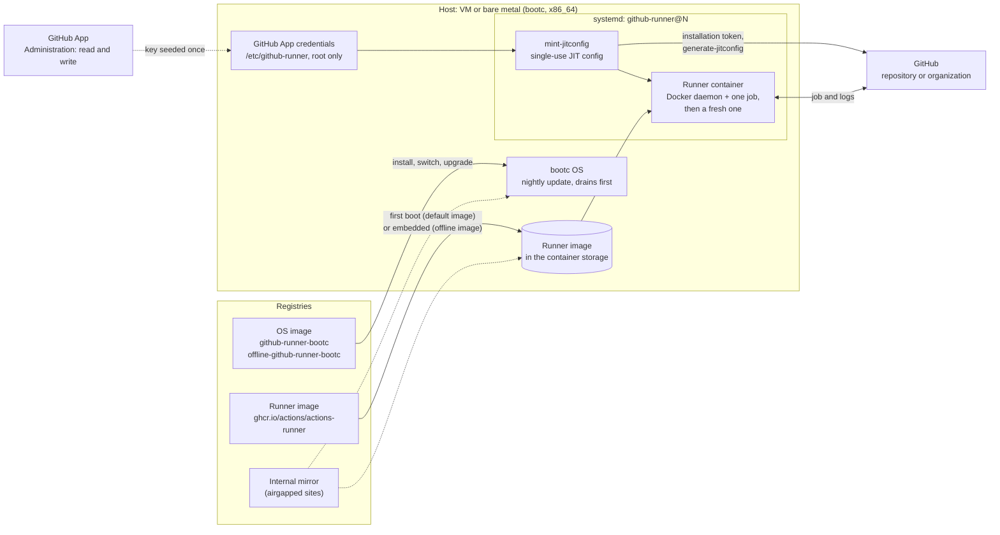

# Architecture



## Flow

```mermaid
sequenceDiagram
    autonumber
    participant U as You
    participant H as Host
    participant S as github-runner@N
    participant G as GitHub

    U->>H: install the image
    U->>H: github-runner-seed-app (GitHub App key)

    loop for every job
        S->>G: installation token, then generate-jitconfig (single use)
        S->>S: start the runner container from the local image<br/>(host adds the NAT rule for its Docker bridges; the container starts dockerd, then the runner)
        S->>G: runner connects and waits for a job
        G-->>S: job
        S->>G: logs and result
        Note over S: the container exits, systemd starts a fresh one
    end

    Note over H: Nightly: bootc upgrade stages an update.<br/>Idle runners stop, busy ones finish, then the host reboots.
```
