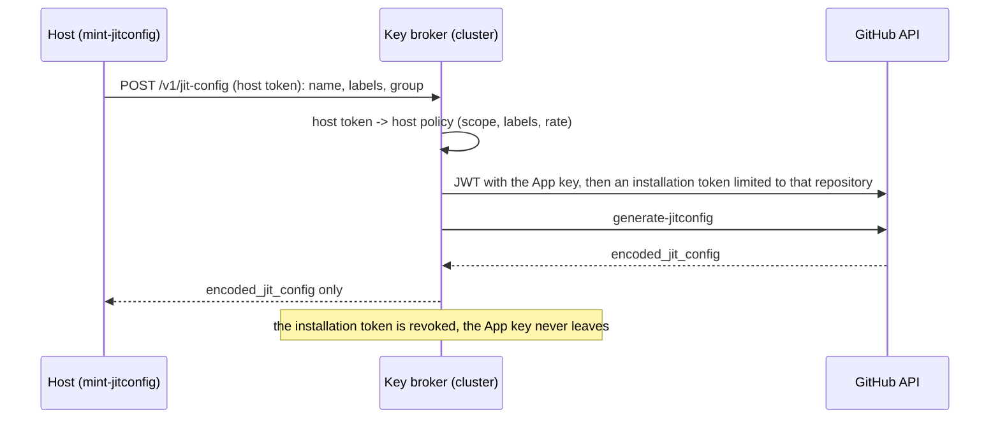

# Design: a key broker for the runner hosts

Status: **proposal, not implemented.** Tracked in [#38](https://github.com/cthtrifork/github-runner-bootc/issues/38).

## Problem

Every host stores the GitHub App private key (encrypted at rest since #78, but a job is root on the host and can decrypt it).
The key never expires and mints installation tokens at will. With `--scope repo:` the App needs **Administration: read and
write**, so a stolen key can change repository settings, remove branch protection, add deploy keys or delete the repository.
The same key is also in the cluster Secret of the two scale sets (see #38).

## Goal

The App key lives in **one** place that no job can reach. A host can get what it needs to run (a single-use JIT runner
configuration for its own repository) and nothing else. A stolen host loses its own access by revoking one token, not by
rotating the App key everywhere.

## Design

- **API:** `POST /v1/jit-config` with `Authorization: Bearer <host token>` and `{name, labels, runner_group_id}`. The **scope is not in the
  request**: the broker takes it from the host's policy, so a host cannot ask for another repository. Answers `200 {encoded_jit_config}`,
  `401` (unknown token), `403` (outside the policy), `429` (rate limit), `502` (GitHub failed).
- **Host policy** (one entry per host, in a config file of the broker): the token's hash, the one allowed scope (`repo:owner/name` or
  `org:name`), the allowed runner group, the labels the host may use, a name prefix, a rate limit (say 30 JIT configs per hour:
  a host mints one per job).
- **Least privilege at GitHub:** the broker requests the installation token with `repositories` and `permissions` set to the
  one repository and the one permission that `generate-jitconfig` needs, and revokes it after the call. The token never leaves the broker.
- **Audit:** one structured log line per request (host, scope, runner name, result) and Prometheus metrics (requests by result,
  rate per host); alert on a burst or on `403`s.
- **On the host:** `mint-jitconfig` calls the broker when `/etc/github-runner/broker-url` exists, otherwise it keeps today's path
  (so hosts migrate one at a time). The host token is stored like the App key is now (`systemd-creds`, #78). A host seeded through the
  broker has no App key, app ID or installation ID: `github-runner-seed-app --broker <url> --broker-token <file>`.
- **Enrolling a host:** generate a random token, add its hash and policy to the broker config, give the token to the host. Revoking is
  deleting the entry.

## Where it runs

A small service in the cluster (`talos-gitops`, like the file server): one image built there, `k8s/apps/key-broker`, the App key as a
SOPS-encrypted Secret mounted as a file, a Cilium policy that allows egress to `api.github.com` only and ingress from the hosts.
One replica is enough: if the broker is down, running jobs are unaffected and idle hosts retry with the back-off from #66.
About 300 lines of Go with tests, a day or two, plus the manifests and the host change.

## What it does and does not fix

| Threat | Today | With the broker |
|---|---|---|
| A job steals the App key from the host | possible (root) | the key is not on the host |
| A stolen host changes repository settings | possible (Administration) | not possible: the host cannot reach those APIs |
| A stolen host registers runners for its repository | possible | still possible, until its token is revoked; bounded by the rate limit and the policy |
| Rotating after an incident | rotate the App key, update every host and the cluster | revoke one host token |
| The broker is compromised | not applicable | the App key is exposed: the broker is the new crown jewel, so keep it small and alone in its namespace |

It does **not** make a job safe on the host (the container is still privileged) and it does not cover the ARC scale sets, which
need the App credentials to talk to GitHub themselves.

## Open questions

1. **Network path:** how do the hosts (VMs on the LAN) reach a Service in the cluster? Through the Omni service exposer or Traefik
   with an internal hostname, over TLS with the private CA (`portableinfo-ca-bundle`)?
2. **Host identity:** a per-host bearer token is the simple start. A client certificate from the private CA (mTLS) is stronger and rotates by
   expiry, at the price of a certificate lifecycle on every host. Start with the token, keep the door open to mTLS.
3. **Enrollment:** by hand (SOPS-edit the broker config in `talos-gitops`) or a small admin command?
4. **GitHub Enterprise:** `api-url` support must be carried through (the broker needs it per host or globally).
5. **Testing:** the broker can be tested against a fake GitHub API; the end-to-end test (`e2e-live`) would need a broker in CI or a
   fake of it.

## Rollout

1. The broker, its manifests and its policy, tested with a throwaway App and repository.
2. `mint-jitconfig` and `github-runner-seed-app` learn the broker mode (the old mode stays).
3. Move hosts one by one; when the last one has moved, rotate the App key so that every old copy on a host is dead.
4. Drop the old mode (and its documentation) once no host uses it.

## Alternatives considered

- **Encrypt the key at rest** (#78): done, but a job is root and can decrypt it; it only helps against a copied disk or snapshot.
- **A separate App per host:** limits one theft to one host, but needs an App, a key and an installation per host: more key material to
  protect, not less.
- **Organization scope** (no Administration permission): not possible for a repository under a personal account.
- **Short-lived keys:** GitHub App keys do not expire; a personal access token is worse.
